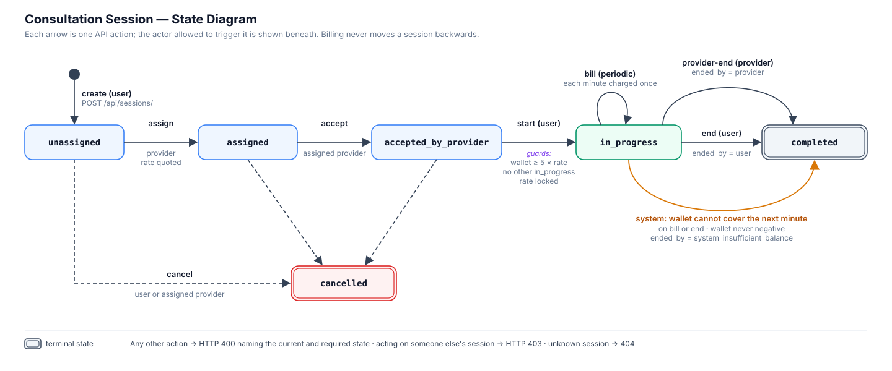
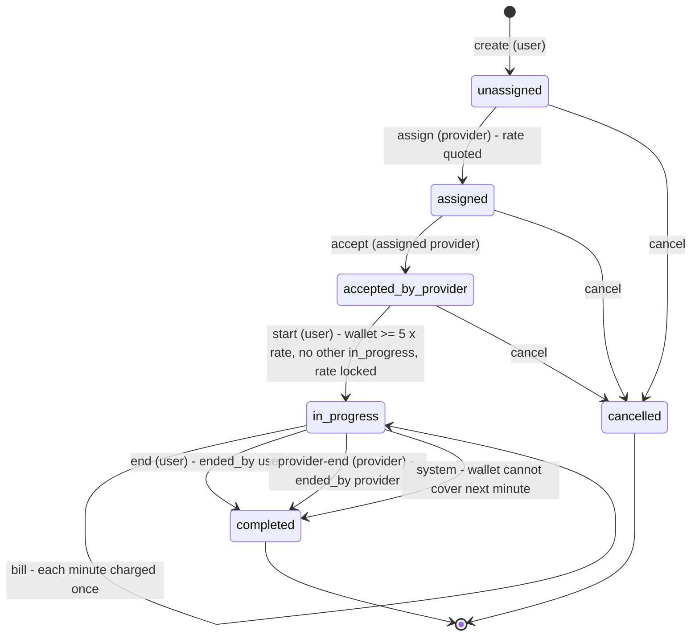
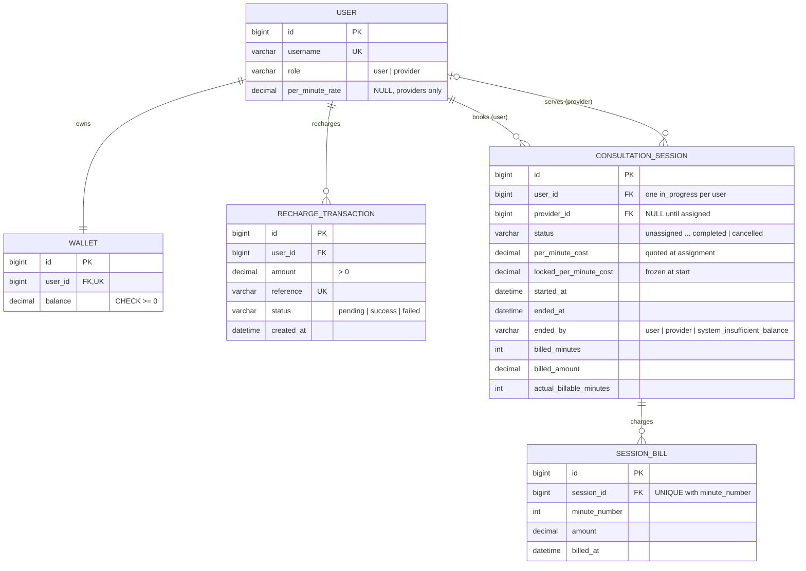

# Assignment Deliverables

## Automated tests

Run all tests (inside the virtual environment):

```powershell
python manage.py test billing
```

The required scenarios are covered in `billing/tests.py`:

| # | Scenario | Test |
| --- | --- | --- |
| 1 | Less than five minutes of balance cannot start a session | `test_insufficient_balance_cannot_start` |
| 2 | Recharge → create → assign → accept → start → bill 2 minutes → end debits correctly | `test_complete_jwt_api_flow`, `test_happy_path_bills_two_minutes_and_ends` |
| 3 | Balance runs out: session auto-ends, wallet never negative, reason recorded | `test_balance_runs_out_without_going_negative`, `test_assignment_example_wallet_stays_at_40_when_next_minute_is_unaffordable`, `test_session_ends_before_an_unaffordable_minute_is_used` |
| 4 | Invalid state transition returns 400 | `test_invalid_transition_returns_400`, `test_accepting_an_unassigned_session_returns_400` |
| 5 | Duplicate success callback credits once | `test_duplicate_success_callback_credits_once` |
| 6 | Duplicate billing does not double-charge | `test_duplicate_billing_does_not_double_charge_a_minute` |

Additional tests cover money validation, the demo seed command, registration, JWT authentication, one active session per user, provider rate locking, partial minutes, provider session discovery, ownership (403), and cancellation.

## Session state diagram



The same lifecycle as a Mermaid diagram (rendered natively by GitHub):



Any other transition returns HTTP 400 with a message naming the current and required state; acting on someone else's session returns 403.

## ER diagram


The same model as a Mermaid diagram (rendered natively by GitHub):



## Important implementation decisions

- `DecimalField` is used for all currency; money is never a float.
- Every state change and wallet movement runs inside `transaction.atomic()` with `select_for_update()` on the session and wallet rows, so concurrent billing/end/callback requests serialise.
- Business rules are also enforced by the database: `balance >= 0` check constraint, a partial unique index allowing one `in_progress` session per user, and `UNIQUE(session, minute_number)` on bills.
- Providers own their price. The rate is quoted onto the session at assignment and frozen into `locked_per_minute_cost` at start; billing always uses the locked value.
- Billing is per complete minute and prepaid: after settling elapsed minutes, if the wallet cannot cover the next minute the system ends the session immediately, so no unpaid minute is ever consumed and the wallet keeps its remainder (e.g. ₹40 at a ₹50 rate). A trailing partial minute is not charged when a session is ended.
- Billing is synchronous via `POST /api/sessions/{id}/bill/`; a client or scheduler calls it periodically. Repeat calls are idempotent because only unbilled elapsed minutes are charged.
- Recharge callbacks are idempotent: only a `pending` transaction may change state, so duplicate success callbacks and late callbacks after a failure never credit twice.
- Ownership violations return 403; wrong-state actions return 400 with a message naming the current and required state.
- Protected endpoints use JWT Bearer authentication. Registration, token endpoints, and the mock payment callback are public; a real gateway callback would require signature verification.
- Money inputs are validated (positive, finite, two decimal places, capped) before they reach the database.
- `python manage.py seed_demo` builds demo data for every lifecycle path through the same service functions the API uses.
- SQLite is used locally; PostgreSQL is selected automatically when `POSTGRES_HOST` is set (Docker Compose).
