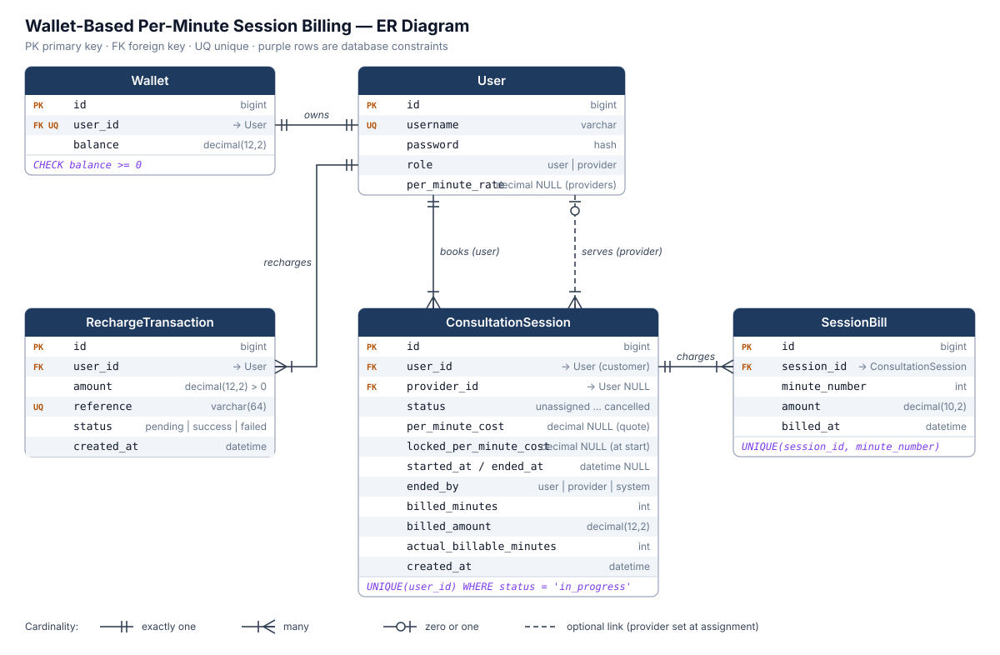

# Wallet-Based Per-Minute Consultation Billing

Small Django REST Framework backend for prepaid one-to-one consultations. It uses SQLite by default and switches to PostgreSQL automatically when `POSTGRES_HOST` is set (as Docker Compose does).

## Setup (local, SQLite)

Requires Python 3.12+ and Django 5.1+. Always run commands inside the virtual environment; an older system-wide Django fails at startup with `CheckConstraint.__init__() got an unexpected keyword argument 'condition'`.

```powershell
python -m venv .venv
.\.venv\Scripts\Activate.ps1
pip install -r requirements.txt
python manage.py migrate
python manage.py runserver
```

## Demo data

```powershell
python manage.py seed_demo          # add --reset to wipe and recreate demo_* data
```

The command drives the real service layer (recharge callbacks, assign/accept/start/bill/end, cancel), so it doubles as an end-to-end check. Every account uses the password `demo1234`:

| Account | Role | Wallet after seeding | What it demonstrates |
| --- | --- | --- | --- |
| `demo_customer` | user | 810.00 | Duplicate success callback credited once (1000), failed and pending recharges never credit; 2-min session ended by user (−100), 3-min session ended by provider at 30/min (−90); sessions parked at `accepted_by_provider`, `assigned`, `unassigned`, plus one `cancelled` |
| `demo_runs_out` | user | 40.00 | 290 at 50/min: 5 minutes paid, then `ended_by=system_insufficient_balance` |
| `demo_low_balance` | user | 100.00 | Accepted session that cannot start (needs 5 × 50 = 250) |
| `demo_provider` | provider | 0.00 | Rate 50.00/min |
| `demo_budget_provider` | provider | 0.00 | Rate 30.00/min |

Log in with `POST /api/token/` as any of these and call the endpoints below to explore.

## Running tests

```powershell
.\.venv\Scripts\Activate.ps1
python manage.py test billing
```

## Docker (Django + PostgreSQL)

```powershell
Copy-Item .env.example .env
# Update the passwords and secret key in .env before starting.
docker compose up --build
```

The API is available at `http://localhost:8000`, and Django Admin is at `http://localhost:8000/admin/`.
The container applies migrations, collects static files, and creates the superuser defined in `.env` on startup.
To stop containers while retaining database data, run `docker compose down`.

## Authentication

Register with `POST /api/users/`. Providers must set their price:

```json
{ "username": "customer", "password": "secret", "role": "user" }
{ "username": "expert", "password": "secret", "role": "provider", "per_minute_rate": "50.00" }
```

Get JWT tokens with `POST /api/token/` (`{ "username": "...", "password": "..." }`) and send the access token on every protected endpoint:

```text
Authorization: Bearer <access_token>
```

Refresh an expired access token with `POST /api/token/refresh/` and `{ "refresh": "..." }`.

## API

| Method | Endpoint | Who | Purpose |
| --- | --- | --- | --- |
| POST | `/api/users/` | anyone | Register a user or provider |
| POST | `/api/token/`, `/api/token/refresh/` | anyone | Obtain / refresh JWT |
| GET | `/api/wallet/` | any | Current caller's wallet balance |
| POST | `/api/recharges/` | any | Initiate mock recharge: `{ "amount": "500.00" }` (status `pending`) |
| POST | `/api/recharges/{reference}/callback/` | mock gateway | `{ "status": "success" }` or `"failed"`; safe to repeat |
| GET | `/api/sessions/` | user / provider | User: own sessions. Provider: own sessions plus unassigned ones |
| POST | `/api/sessions/` | user | Create an `unassigned` session |
| POST | `/api/sessions/{id}/assign/` | provider | Assign self; quotes the provider's rate onto the session |
| POST | `/api/sessions/{id}/accept/` | assigned provider | Accept |
| POST | `/api/sessions/{id}/start/` | session user | Start; wallet must hold 5 × rate; rate is locked |
| POST | `/api/sessions/{id}/bill/` | participant | Charge all complete elapsed minutes (call periodically) |
| POST | `/api/sessions/{id}/end/` | session user | End |
| POST | `/api/sessions/{id}/provider-end/` | assigned provider | End |
| POST | `/api/sessions/{id}/cancel/` | participant | Cancel a session that has not started |

Invalid state transitions return **400** with a `detail` message naming the current and required state. Acting on a session you are not part of returns **403**.

## State diagram

```text
unassigned --assign--> assigned --accept--> accepted_by_provider --start--> in_progress --end--> completed
     |                     |                        |                           |
     +---------------------+------- cancel ---------+                           +-- system: insufficient balance --> completed
                           v
                       cancelled
```

## ER diagram



See [ASSIGNMENT_DELIVERABLES.md](ASSIGNMENT_DELIVERABLES.md) for a Mermaid version of the diagram and the implementation decisions.

## Implementation notes

- All balance and state changes run in `transaction.atomic()` with `select_for_update()` row locks.
- **Pricing:** providers own `per_minute_rate`. It is copied to the session at assignment (the quote shown to the user) and frozen into `locked_per_minute_cost` at start, so later rate changes never affect a running session.
- **Billing:** each call charges complete elapsed minutes minus `billed_minutes`. `SessionBill(session, minute_number)` is unique, so a minute can never be charged twice. A trailing partial minute is **not** charged when a session ends (2m59s bills 2 minutes).
- **Insufficient balance:** billing is prepaid per minute. Immediately after charging, if the wallet cannot cover the next minute, the system completes the session with `ended_by=system_insufficient_balance`; the wallet is never debited below zero (also enforced by a database check constraint). `actual_billable_minutes` records the paid talk time.
- **Recharge idempotency:** only a `pending` recharge can change state or credit the wallet; repeated or late callbacks return the recorded transaction unchanged.
- **Money validation:** amounts must be positive, finite, have at most two decimal places, and stay within caps (recharge 1,000,000; rate 100,000/min; wallet 9,999,999,999.99) so the database columns can never overflow.
- The mock callback endpoint is unauthenticated because there is no real gateway. In production it must verify a gateway signature or shared secret.
